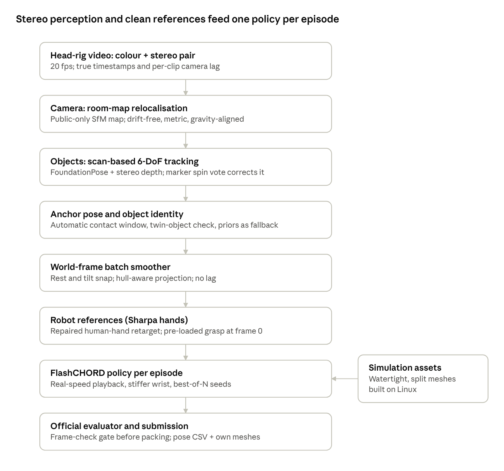

[← Index](README.md)

# V2D Challenge Track 3 — Research Summary and Proposed Direction

Oct 10, 2026 · Ahmet Ercan Batırel

## Summary

We propose to enter Track 3 of NVIDIA's Video-to-Data (V2D) Challenge with a stereo, object-first pipeline that fixes the failure points we found in NVIDIA's baseline. The score is decided by how closely a simulated robot reproduces the real object motion in 20 egocentric videos. We have done about two weeks of research, all on a laptop CPU with public data; nothing has been trained or submitted yet.

- **What we found:** most of the score is lost to bookkeeping and robustness, not to model choice. We found a silent timing bug in the official default settings, unobservable object spin, camera drift, inflated simulator collision shapes and a weak robot wrist at real speed. Each has a tested or designed fix.
- **Direction:** use the stereo camera pair the baseline ignores, relocalise the head camera against a fixed room map, track objects with their scans plus a mocap-marker correction layer, and clean up references physically before training per-episode policies.
- **Where it stands:** the Track 3 leaderboard leader has ADD-AUC 0.649 (2026-10-06). Our modelled estimate for a working pipeline is 0.65-0.85, central 0.75, which is unmeasured.
- **Ask:** feedback on the direction, and help with GPU access. Policy training needs an NVIDIA GPU with at least 48 GB; a first score needs roughly 15-90 GPU-hours.

## The challenge

Track 3 asks for an end-to-end pipeline from egocentric human video to a simulated robot that reproduces the manipulated objects' motion. Scoring uses only the final simulated object trajectories, against motion-capture ground truth. Details: [track3-requirements.md](track3-requirements.md).

- **Data:** 20 public episodes with mocap object poses, and 20 evaluation episodes with video only. A head-mounted OAK rig gives one colour camera (2028x1520) and a mono stereo pair (1280x800, 75 mm baseline) at 20 fps, about 13 s per clip. There are 10 tabletop tasks and 11 objects; 10 objects have public textured scans. A wooden spoon appears in 10 of the 20 evaluation episodes and has no scan.
- **Pipeline required:** reconstruct objects (and hands) from video, train one RL policy per episode in NVIDIA's FlashCHORD simulator (Newton/MuJoCo-Warp, FlashSAC), then roll it out with the official evaluator. Each submission records evaluator, checkpoint and code hashes plus a Git commit.
- **Metrics:** ADD-AUC (1-9 cm), SP-SR and MP-SR success rates (10 cm / 0.5 rad; 3 cm / 30 deg), RPE and MPPE, plus Chamfer distance (CD-O) of our own reconstructed meshes. One rigid alignment is taken from the first object's first-frame pose; scale is not corrected. The public aggregator ranks by ADD-AUC.
- **Rules:** pretrained models and external data allowed; no hand labelling of test videos; winners release code under Apache-2.0 and must reproduce results. Five submissions a week, unlimited in the final three days; leaderboard freeze 2026-11-04.

| Team (Track 3, 2026-10-06) | ADD-AUC | SP-SR | MP-SR | MPPE (cm) | CD-O (cm) |
| --- | --- | --- | --- | --- | --- |
| SoySauceChicken | 0.649 | 0.35 | 0.25 | 7.28 | — |
| Panav Raaj | 0.212 | 0.05 | 0.00 | 15.22 | 0.112 |

For scale, a prediction where nothing moves scores about 0.45 AUC on the public episodes ([02 error budget](notes/02-error-budget.md)).

## NVIDIA's baseline and its gaps

NVIDIA's starter pipeline is a monocular chain built for in-the-wild video, and several of its assumptions do not hold on this dataset. Full dissection: [01 baseline dissection](notes/01-baseline-dissection.md).

| Stage | Baseline method | Gap on Track 3 data |
| --- | --- | --- |
| Depth and scale | MoGe-2 monocular depth | The 75 mm stereo pair is never used; monocular metric depth is off by about 8-16% |
| Camera motion | DROID-SLAM (mono), scale from MoGe | World frame drifts; no fixed room reference |
| Objects | Grounding DINO + SAM2, SAM3D mesh, FoundationPose | Tracks one object only; re-registration fires during grasps; cup spin is unobservable from shape |
| Hands to robot | HaMeR/Dyn-HaMR, plain IK retarget to Sharpa hands | Smoothing and de-penetration options are off by default; contacts are noisy |
| Loader | Writes 30 fps, one body | Data is 20 fps with 1-2 objects |
| Policy | FlashSAC, motion_speed 0.5 | Default playback silently misaligns exported rows (see findings) |

NVIDIA's own Track 2 numbers show the stakes: with clean motion capture their policy reaches AUC 0.51, and with an off-the-shelf video reconstruction it falls to 0.002.

## Key findings

The largest losses come from a few specific failure modes, which we quantified with the official scorer on public ground truth and checked with independent re-runs.

| Finding | Evidence | Impact (ADD-AUC) | Fix | Notes |
| --- | --- | --- | --- | --- |
| Losing a manipulated object is the worst error | Most-moved object dropped: AUC 0.55, MP-SR 0.05 | About -0.4 per episode | Robust tracking through grasps; policy drop prevention | [02](notes/02-error-budget.md) |
| Silent timing bug in the default recipe | Half-speed playback exports ~2 rows per frame; packer keeps the first N | Caps AUC near 0.42 even with perfect tracking | Real-speed playback at the true 20.0 fps plus a frame-check gate | [06](notes/06-timing-audit.md) |
| World drift | 5 cm end-point drift | About -0.20 | Room map: relocalise every frame against a fixed SfM map (1-2 mm, all 20 eval clips covered) | [18](notes/18-room-map.md) |
| Symmetric anchor objects | Cup spin unobservable from shape; scorer aligns on the first object | 10 deg error: AUC 0.71 on that episode | Mocap-marker spin vote; per-task placement priors (cup AUC 0.28 to 0.87 in leave-one-out) | [11](notes/11-placement-priors.md), [12](notes/12-symmetry-observability.md), [17](notes/17-marker-tracking.md) |
| Object frame conventions | Scan frames follow a centroid + PCA rule; spoon roll sign ambiguous | Wrong spoon roll: about -0.5 SP-SR on its episodes | Canonicalise our meshes by the rule; ask organisers about the spoon | [07](notes/07-mesh-frame-convention.md), [13](notes/13-spoon.md), [20](notes/20-sync-spoon-contact.md) |
| Inflated collision hulls | Simulator decomposition inflates contacts 4-15 mm | Objects ejected at reset in about 10 episodes | Watertight and split collision meshes (+0.5-1 mm over floor), hull-aware references | [15](notes/15-eval-video-survey.md), [19](notes/19-collision-hulls.md) |
| Weak wrist at real speed | Holding 0.3 kg uses 11.8 cm of the 0.2 m action range | Policy-only estimate: AUC 0.76-0.84 per seed on a perfect reference | Stiffer wrist variant or 10 Hz exact-row control; best-of-N seeds | [14](notes/14-policy-tracking-error.md) |

Two further results matter for design: the head camera and room are fixed across sessions, so a map built from public frames alone locates every evaluation clip; and mocap markers help as a correction layer (about +0.04 AUC) but cannot be the primary tracker, since they are lost during grasps.

## How others approach it

The field splits the problem into perception (video to 4D hand-object motion) and transfer (motion to robot policy), and recent work agrees that the reference's physical consistency matters more than the RL algorithm. Reviews: [03 perception literature](notes/03-lit-perception.md), [04 transfer literature](notes/04-lit-transfer.md), [05 alternatives](notes/05-alternatives.md).

**Perception.** FoundationPose remains the strongest model-based 6-DoF tracker when a mesh and metric depth are available (ADD-AUC 96.0 on YCB-Video). On HOT3D, the benchmark closest to our head rig, stereo locates in-hand objects within 10 cm 96.8% of the time against 30.2% for monocular depth. Common pieces are SAM2/SAM3 segmentation, FoundationStereo depth, HaMeR/WiLoR hands, and BundleSDF or SAM 3D Objects for meshes. Many of these ship under non-commercial licences, a risk given the Apache-2.0 release rule.

**Transfer.** NVIDIA's CHORD (contact-wrench guidance, about 2 GPU-hours per sequence on an L40S) is the method behind the challenge simulator. DexMachina adds a virtual-object-controller curriculum, ManipTrans residual learning, and SPIDER physics-informed sampling. Reported reference repair results are large: Regrind about 3% to 99% success, V2P-Manip 0% to 79%, C2Dex 18% to 58%. Bimanual tracking is much harder than single-hand (about 20-39% vs 55% success in one large benchmark).

**Competitors.** Two teams are on the Track 3 board; no method write-ups are public. The leader's profile (AUC 0.649, MP-SR 0.25) is consistent with a working pipeline that loses objects or episodes. In Track 2, one team already beats NVIDIA's CHORD baseline at every tier.

## Proposed architecture

Our direction keeps NVIDIA's simulator and evaluator but replaces the perception front end and cleans the references, because that is where the measured losses are. Design history: [08 accuracy panel](notes/08-architectures-accuracy.md), [09 resourceful panel](notes/09-architectures-resourceful.md), syntheses [10](notes/10-synthesis.md), [16](notes/16-synthesis-round3.md), [21](notes/21-synthesis-round4.md).

Each stage targets one loss from the findings table: the room map removes drift, the scan tracker plus markers fixes spin and object loss, the anchor stage protects the scorer's alignment, and clean references plus fixed assets reduce policy drops.

**Why this makes sense.** It uses the sensor the baseline ignores (the stereo pair), exploits facts specific to this dataset (fixed room, scanned objects, visible mocap markers), and every stage can be scored on public ground truth before any GPU spend. It also fits the panel-judged Industry Innovation award: cheaper perception, reuse across episodes, and less dependence on 3-D human hand reconstruction.

**Alternatives considered.**

- **Baseline+** (NVIDIA's chain with quick fixes): built first as the control and safety net.
- **Hands-free grasp synthesis:** generate robot grasps from object motion alone; kept per segment only, since it likely fails on hand-overs, flips and twirls.
- **Sim-verified sampling then distillation:** search executable motions in the simulator, then distil; reserved for failing episodes.
- **Joint whole-clip estimation:** one optimisation over all frames and cameras; too large for the timeline, used only on the worst episodes.
- **Vision-language-action or world models:** not viable, since the evaluator accepts only FlashCHORD checkpoints.

## Risks and open questions

The biggest unmeasured risk is how often the robot policy drops or never grasps objects, which only GPU runs can measure.

- **Hard manipulations:** hand-overs, flips, in-hand twirls and sliding appear in 5-8 of 20 evaluation episodes ([15](notes/15-eval-video-survey.md)). We have identified them but not yet researched solutions.
- **Real tracker error:** our marker and anchor gains were measured against an emulated tracker; a real FoundationPose run is pending.
- **Spoon frame:** the roll sign of the unscanned spoon is close to a coin flip (P about 0.45-0.5) without an organiser answer.
- **Contact-rich tasks:** stirring, spoon insertion into a rack slot, cup nesting and lid placement are untested in simulation.
- **Reproducibility:** simulator physics is not deterministic by configuration, and winners must reproduce results; the collision decomposition differs between macOS and Linux.
- **Licences:** several best-in-class models are non-commercial; the Kaggle open-source clause and the Apache-2.0 release need organiser clarification.
- **Open organiser questions:** whether AUC alone ranks; the spoon frame; intended playback speed; whether collision meshes, masses and wrist variants are ours to set; evaluation world count and platform.

## Plan, compute and cost

We aim for a first valid submission within about two weeks of getting GPU access, then improve in measured stages until the 2026-11-04 freeze.

1. **GPU day 1:** smoke-test FlashCHORD at real speed on one public episode to measure training speed, memory and determinism; build the fixed collision assets on Linux.
2. **Baseline+ submission:** NVIDIA's pipeline with the timing fix, true frame rate, multi-object support and stereo depth.
3. **Staged upgrades, each scored on public episodes first:** room-map cameras, scan-based tracking with the marker layer and anchor fixes, hull-aware references, then wrist and seed improvements.
4. **Final week:** freeze the recipe, run final seeds, use the unlimited last three days to choose between genuine pipeline variants.

| Run | What it gives | GPU-hours | Approx. cost (L40S-class) |
| --- | --- | --- | --- |
| Smoke test | Real training speed, memory, determinism | 2-4 | About $5 |
| Minimum first score | Short training, crude reference, 1 seed per episode | 15-30 | $15-40 |
| Decent first score | Full recipe, 1 seed per episode, plus setup | 50-90 | $40-120 |
| Competitive campaign | Several seeds and retrain cycles to the freeze | 300-650 | $300-850 |

Policy training and evaluation need an NVIDIA GPU with CUDA (at least 48 GB for the default recipe); they cannot run on Apple Silicon. Camera mapping, timing, marker detection, anchor detection, mesh building and scoring already run on a laptop CPU.

## Sources

- [V2D Challenge page](https://nvidia-isaac.github.io/video_to_data/v2d_challenge/) and its FAQ
- [nvidia-isaac/video_to_data repository](https://github.com/nvidia-isaac/video_to_data) (evaluator pin 8c778f90)
- [Track 3 dataset on Hugging Face](https://huggingface.co/datasets/nvidia/video_to_data_challenge/tree/main/track_3)
- [Kaggle Track 3 rules](https://www.kaggle.com/competitions/v2d-challenge-track3-auc/rules)
- [Leaderboard data](https://raw.githubusercontent.com/MVerghese/v2d-leaderboard-data/main/leaderboard.json)
- [CHORD, arXiv 2607.00033](https://arxiv.org/abs/2607.00033) and [FlashSAC, arXiv 2604.04539](https://arxiv.org/abs/2604.04539)
- Our research notes 01-21 — see the [index](README.md).
