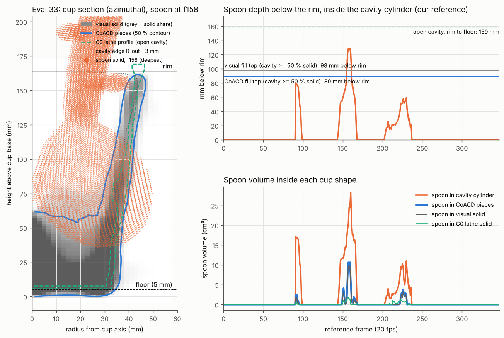
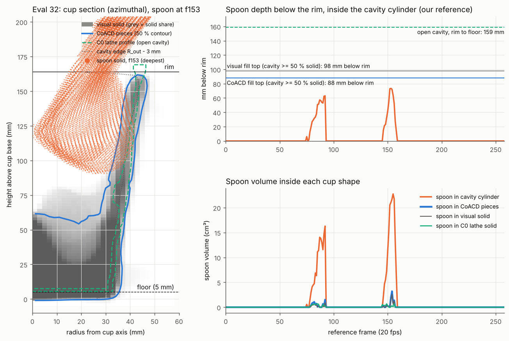
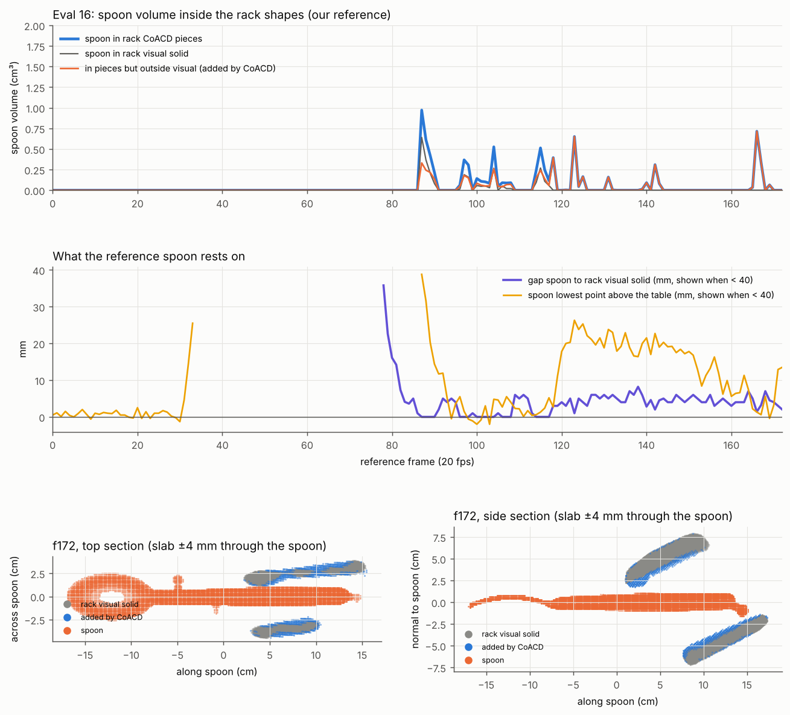

# Spoon vs packed collider: blue cup (evals 32, 33) and dish rack (eval 16)

2026-10-31, ~18:30–19:10 UTC. CPU only, this cloud container, $0. GT-free.

**Question.** In the video of evals 32 and 33, the spoon scoops inside the blue cup. In simulation it stays beside the
rim. Is that because the packed blue cup's collision shape fills the cavity where our reference puts the spoon? For eval
16 (the spoon flips on release into the rack), does the spoon go into a rack seat that the collider fills?

Tags: [M] measured here, [E] estimate, [H] hypothesis.

## Answer

| | Eval 32 | Eval 33 | Eval 16 (rack) |
|---|---|---|---|
| Does the packed collider block the reference spoon? | **No.** The spoon goes at most 73 mm below the rim, above the fill; ≤ 2.6 cm³ in the visual solid, ≤ 3.2 cm³ in the CoACD pieces | **Only at the bottom of the deepest dip** (f155–161). The spoon reaches 128.7 mm below the rim, 35 mm above the base; up to 9.8 cm³ in the solid, 19 mm deep. Free (≤ 0.1 cm³) in 33 of its 66 in-cup frames | **No.** ≤ 0.64 cm³ in the visual solid, ≤ 0.97 cm³ in the pieces, no frame above 1 cm³ |
| What fills it | The visual mesh itself. CoACD adds ≤ 1.0 cm³ | (same) | (no filled seat) |
| Would a cavity-preserving carved shape let the spoon in? | Yes. Spoon in the C0 lathe solid ≤ 0.69 cm³ | Yes, to the full 128.7 mm. Spoon in the C0 lathe solid ≤ 1.76 cm³ (≤ 0.70 inside the cavity cylinder) | Nothing to carve |

All numbers in this table are [M].

- **Eval 33.** The fill blocks only about 5–7 frames of the deepest scoop. It does not explain why the spoon stays
  beside the rim for the whole scoop: in about half of the in-cup frames, the packed collider has nothing in the way. [M]
- **Rack (eval 16).** The reference spoon is not supported. From f120 on, it hangs 1–8 mm from the rack (median 4.5 mm) and,
  until f150, 16–26 mm above the table. [M] That could make the release flip, but this is a hypothesis [H] (section 5).

## 1. Inputs (integrity)

- **References.** The packed references are listed in focused-pascal's
  `docs/research/work/masses-eval-20261031/packed_refs.json` (branch `claude/focused-pascal-2nz9s1`). I downloaded them
  from the HF store `aebatirel/v2d-store`; their md5 matches the list.
  - Eval 32: `runs/20261026-fr32s46b-5e0e100/refs/glockt/ep32/.../ref_gl_ilc.parquet`, md5 `36e600c8`, 259 frames.
  - Eval 33: `runs/20261026-fr3233s43-6a8a0e2/refs/glockt/ep33/.../ref_gl_ilc.parquet`, md5 `2a7173ab`, 348 frames.
  - Eval 16: `runs/20261024-pack-31ef267/refs/glockt/ep16/.../ref_gl_ilc.parquet`, md5 `f7e2ea92`, 173 frames.
- **Columns read.** Only `object_body_names`, `object_body_position` and `object_body_wxyz`. The pose columns are what
  the policy imitates. I also read `object_urdf_paths`, `object_mesh_paths` and `fps` to identify the assets.
- **Not read.** No scan, mocap, public GT parquet or `*_align` file.
- **Meshes.** These are the simulator assets of the packed runs (each reference's `object_urdf_paths` points there):
  - Eval 32 cup and spoon: `refs/sf/ep32/assets`. These are library_v3 plus support fill: a 19.4 cm³ slab under the cup
    base (f203 rest) and 99.7 vs 84.8 cm³ for the spoon.
  - Eval 33 cup: identical to `meshes/library_v3/blue_cup.glb` (same vertices and faces).
  - Eval 33 and 16 spoon, and the eval 16 rack: same geometry as library_v3.
  - C0 lathe: the profile in `cdo-sprint/C0/meshes/ep21_blue_cup_g1.lathe.json`, as an analytic solid of revolution.
    Its glb is not watertight.
- **CoACD.** I reproduced FlashCHORD's call exactly: `run_coacd(Mesh(v_f64, f_i64), threshold=0.05,
  max_convex_hull=-1, preprocess_mode="auto")`, with the mesh loaded by `trimesh.load(force="mesh")`.
  - This venv has coacd 1.0.14; FlashCHORD pins 1.0.11.
  - Cross-check against the 26 Oct census, which used FlashCHORD's own `convex_decompose` with 1.0.11
    (`docs/analysis/forensics-20261026/hull_census/ep33_sub.json`, stride 3). The version does not change the answer:

    | Item | 26 Oct census (1.0.11) | Here (1.0.14) |
    |---|---|---|
    | Cup pieces | 75 (450.4 cm³) | 65 (452.9 cm³) |
    | Rack pieces | 43 (1210.6 cm³) | 38 (1252.2 cm³) |
    | Spoon pieces | 10 (97.5 cm³) | 9 (100.4 cm³) |
    | Eval 33, spoon in cup mesh / pieces / pieces only | 9.80 / 10.74 / 0.94 cm³ | 9.77 / 10.71 / 1.01 cm³ |
    | Eval 16, spoon in rack pieces | 0.89 cm³ | 0.97 cm³ |

## 2. How solid the packed blue cup's cavity is (`results/spoon_diag.json` → `cavity`)

**Cup frame.** I took it from the library_v3 mesh's own solid:
- axis = the line fit through the slice-hull centroids; it is the mesh's −z, and the base is at +z;
- rim 164.0 mm above the base;
- outer radius 36.7 mm 1 cm above the base, 39.8 mm at mid-height, 41.5 mm at the rim.

**Cavity.** Defined as the cylinder r < R_out(h) − 3 mm, from 5 mm above the base up to the rim. Its volume is
688.7 cm³. Solid inside it, by shape:

| Shape | Solid in the cavity | ≥ 50 % of the cross-section solid up to | Depth below the rim |
|---|---|---|---|
| Visual / sim mesh | 266.5 cm³ (38.7 %) | 66 mm above the base (40 % of the height) | 98 mm |
| CoACD pieces | 296.6 cm³ (eval 32) / 297.6 cm³ (eval 33), 43 % | 75–76 mm (46 %) | 88–89 mm |
| C0 lathe | 37.2 cm³ (5.4 %: its floor and walls; 2.5° / ~5 mm frame offset) | 8 mm (its floor) | 156 mm |

Solid share of the cavity by height band (eval 33; eval 32 within 0.04):

| h above base (cm) | 0–1 | 1–2 | 2–3 | 3–4 | 4–5 | 5–6 | 6–7 | 7–8 | 8–9 | 9–10 | 10–16 |
|---|---|---|---|---|---|---|---|---|---|---|---|
| Visual | 1.00 | 1.00 | 0.98 | 0.88 | 0.77 | 0.66 | 0.52 | 0.41 | 0.26 | 0.18 | 0.11–0.17 |
| CoACD | 1.00 | 1.00 | 0.99 | 0.91 | 0.82 | 0.71 | 0.59 | 0.49 | 0.34 | 0.24 | 0.15–0.21 |
| C0 lathe | 0.39 | 0.07 | 0.06 | 0.05 | 0.05 | 0.03 | 0.06 | 0.14 | 0.10 | 0.03 | 0.00–0.05 |

- **The ledger figure holds.** The ledger's "lower ≈ 37 % solid" matches: the visual cavity is half solid up to 40 % of
  the height. [M]
- **Upper bands.** From 10 cm up, the 0.11–0.17 is the visual's non-round, thick wall cutting the 3 mm cylinder, not fill.
  The lathe has 0.00–0.05 in the same cylinder.

## 3. Spoon vs blue cup, per frame (`results/spoon_diag.json` → `per_frame`; `results/collider_pair.json`)

The spoon solid (1.5 mm voxels) is placed at our reference pose in the cup frame. "Depth" means how far below the rim the
spoon goes inside the cavity cylinder.

| | Eval 32 | Eval 33 |
|---|---|---|
| Frames with spoon inside the cavity cylinder | 30 (f75–92, f146–158) | 66 (f91–98, f144–167, f203–236) |
| Max depth below the rim | **73.4 mm** (f153) | **128.7 mm** (f158) |
| Median depth (in-cavity frames) | 41 mm | 48 mm |
| Lowest spoon point above the base | 90.6 mm | 34.8 mm (f157) |
| Frames below the visual / CoACD fill top | 0 / 0 | 5 / 7 (f155–161) |
| Max spoon volume in the cavity cylinder | 22.7 cm³ | 28.3 cm³ |
| Max spoon volume in the visual solid (frames > 1 cm³) | 2.58 cm³ (3) | **9.77 cm³ (20)**; > 5 cm³ only f156–160 |
| Max spoon volume in the CoACD pieces (frames > 1 cm³) | 3.20 cm³ (5) | **10.71 cm³ (22)** |
| Max in the pieces but outside the visual | 0.63 cm³ | 1.01 cm³ |
| Max penetration into the visual solid | 6.0 mm | **19.0 mm** |
| In-cavity frames with ≤ 0.1 cm³ in the pieces | 12 / 30 | 33 / 66 |
| **C0 lathe:** max spoon volume in its solid (frames > 1 cm³) | 0.69 cm³ (0) | 1.76 cm³ (8) |
| **C0 lathe:** same, inside the cavity cylinder only | 0.42 cm³ | 0.70 cm³ |
| Collider vs collider: spoon pieces in cup pieces, max (frames > 1 cm³) | 4.42 cm³ (9) | 15.81 cm³ (23) |
| Spoon pieces in the C0 lathe solid, max (frames > 1 cm³) | 1.27 cm³ (4) | 2.56 cm³ (13) |

- **What the spoon's own pieces add.** The spoon's CoACD pieces add 15.4 cm³ to the spoon (21.0 cm³ for the
  support-filled eval 32 spoon), mostly the filled bowl. Of that, ≤ 5.2 cm³ lies in the cup pieces (eval 33). [M]
- **The small intrusions at 50–60 mm depth** (eval 33 f150–152 and f223–230; eval 32 f80–92) are wall contacts, not
  cavity fill. They are ≤ 3.2 cm³ and ≤ 6 mm deep, and they also show on the lathe at up to ~1 cm³. [M]




How to read the plots:
- **Left panel.** Azimuthal cup section (grey = visual solid share; blue = CoACD 50 % contour; green dashed = C0 lathe
  profile on its own axis, base mapped). The spoon solid is shown at its deepest frame.
- **Right panels.** Per-frame depth below the rim, and spoon volume inside each shape.

## 4. Spoon vs rack, eval 16 (`results/spoon_diag.json` → `16`; `results/ev16_support.json`)

The spoon is within 2 cm of the rack's bounding box from f79 to f172.

| Measure | Value |
|---|---|
| Max spoon volume in the rack visual solid | 0.64 cm³ (f87); 0 frames > 1 cm³ |
| Max spoon volume in the rack CoACD pieces (38) | 0.97 cm³ (f87); 0 frames > 1 cm³ |
| Max in the pieces but outside the visual | 0.71 cm³ (f166) |
| Max penetration | 4.0 mm (visual); 6.2 mm into one piece (f123, 0.65 cm³) |
| Collider vs collider (spoon pieces in rack pieces) | 0.84 cm³ max; 0 frames > 1 cm³ |
| Gap from spoon to the rack visual solid, f120–172 | 1.0–8.2 mm (median 4.5; 10–90 % 3–6); f172: 2.0 mm |
| Spoon lowest point above the table, f120–150 | 16–26 mm; then −0.4–17 mm, jittery; f172: 13.5 mm |

- **Where the spoon sits.** At f172 the handle lies in the slot between two rack plates (section plot). CoACD adds a skin
  of ≤ ~2 mm on the plates, and nothing fills the slot.
- **No support from rest frames on.** The support-fill step had already noted that at its rest frames 128 and 142 the
  spoon is 1.9–2.2 cm above the table, "resting on something else". In fact it rests on nothing in our meshes. [M]



## 5. Hypotheses and the experiments that would falsify them

- **H1 (eval 33): the cup fill costs the deepest dip, not the scoop.**
  - The claim: carving the cup would remove the f155–161 conflict, about 10 cm³ and 19 mm. It would not, by itself,
    keep the spoon inside the cup during f144–154 and f203–236, where the packed collider is already free.
  - Context from the forensics of 26 Oct (not measured here): the simulated cup and spoon are both 4–10 cm off target
    from f90 to f290 (two-handed hold).
  - Falsifying experiment: replay eval 33 on GPU with (a) the library_v3 cup and (b) a cavity-preserving lathe cup (ring
    pieces, `pipeline/lathe_collision.py`). Log the spoon-in-cup depth and the cup's tracking error per frame. If (b)
    changes the spoon depth only in f155–161, H1 holds.
- **H2 (carved cup).** The C0 lathe admits the reference spoon. But FlashCHORD's CoACD 0.05 would refill a cup cavity:
  on the packed cup it adds 31 cm³ over the visual. So the lathe must ship as cavity-preserving convex pieces. Test:
  rerun `analyze.py` with the lathe's pieces as `hulls`; expect ≤ 2 cm³ of spoon in the pieces.
- **H3 (eval 16 flip).** The spoon falls 1–8 mm onto the rack plates at release, because our reference holds it in free
  space. The first contact then decides the rotation; no filled seat is involved.
  - Falsifying experiment: settle the f128 / f142 reference spoon pose in FlashCHORD, assist off, with the rack fixed.
  - If it lands without flipping in all seeds, H3 is wrong.

## 6. Reproduce

The scripts are in `scripts/`; `config_scratch.json` holds the scratchpad paths used here. Python 3.13 venv with
trimesh 4.x, numpy, scipy, pyarrow, coacd 1.0.14 and huggingface_hub. Plots use a separate matplotlib 3.11 venv.

```
python -I scripts/dl.py DL && python -I scripts/dl2.py DL                       # HF store: refs + sim assets
python -I scripts/run_coacd.py OUT cup_ep32sf=<ep32 sf blue_cup.glb> cup_lib=meshes/library_v3/blue_cup.glb rack_lib=meshes/library_v3/plastic_dish_rack.glb
python -I scripts/run_coacd.py OUT/spoon spoon_ep32sf=<ep32 sf wooden_spoon.glb> spoon_lib=meshes/library_v3/wooden_spoon.glb
python -I scripts/analyze.py scripts CONFIG OUT                                  # spoon_diag.json, plotdata.npz (~200 s)
python -I scripts/ev16_support.py scripts CONFIG OUT                             # ev16_support.json
python -I scripts/collider_pair.py scripts CONFIG OUT OUT/spoon/spoon_ep32sf_coacd.npz OUT/spoon/spoon_lib_coacd.npz OUT/spoon/spoon_lib_coacd.npz
python -I scripts/plots.py OUT docs/research/mesh-2026-10-26/cdo-sprint/C0/meshes/ep21_blue_cup_g1.lathe.json
```

**Method notes:**
- `vox.py` voxelises by exact vertical-ray parity. The cup comes out at 398.9 cm³ against a mesh volume of 400.3.
- Volumes use 1 mm container voxels and 1.5 mm spoon voxels.
- Hull penetration is per piece, so it is a lower bound for the union.
- `results/coacd_report_*.json` record the piece counts and timings. The CoACD pieces themselves (npz) are not
  committed; regenerate them with `run_coacd.py`.

**Cost.** CPU only, $0. Runtime: CoACD ~10 min in total on the loaded machine, analysis ~3.5 min.

**Not done here.** `STATUS.md` and `docs/work-log.md` are shared files, left to the orchestrator.
